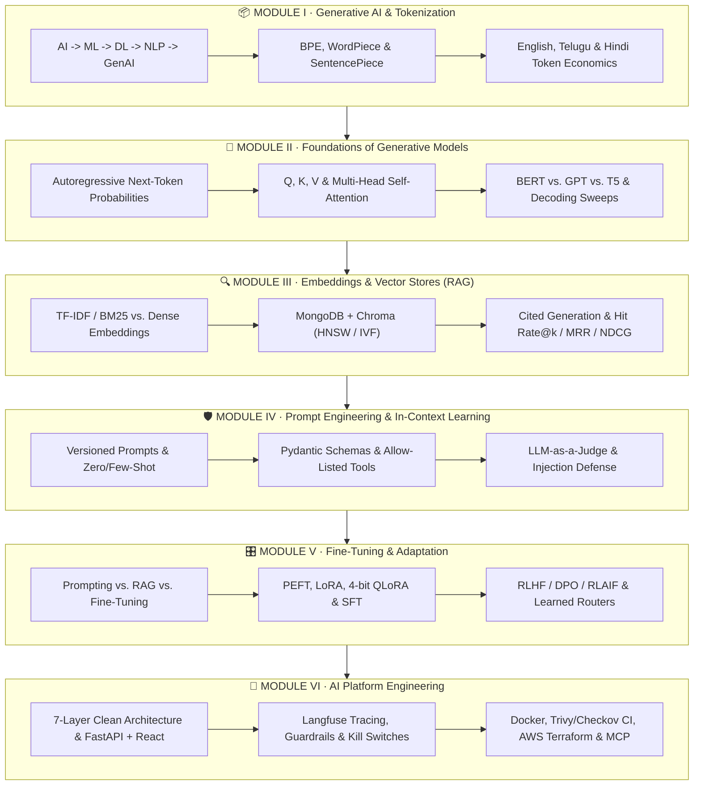

# 🧠 Generative AI & AI Platform Engineering
### `25CS2207E` · Complete Course Syllabus & Learning Roadmap

[-f59e0b?style=for-the-badge)](#)

  <em>A comprehensive, industry-aligned curriculum covering the complete engineering lifecycle of Generative AI systems—from tokenization mechanics and Transformer internals to Retrieval-Augmented Generation (RAG), Parameter-Efficient Fine-Tuning (PEFT), microservices, observability, and cloud Infrastructure as Code.</em>

---

[✨ Overview](#-what-you-will-learn) •
[🛠️ Tech Stack](#️-industry-tech-stack--tools) •
[🗺️ Curriculum Map](#️-curriculum-architecture-map) •
[📚 6 Core Modules](#-detailed-module-wise-syllabus) •
[🎓 Course Outcomes](#-course-outcomes-cos) •
[🧪 40 Skilling Labs](#-40-hands-on-skilling-labs) •
[🗓️ 30 Lectures](#️-30-session-classroom-lecture-plan) •
[📖 Textbooks](#-textbooks--learning-resources)

---

## ✨ What You Will Learn

This course bridges the gap between **foundational language model theory** and **production AI platform engineering**. Rather than treating Large Language Models (LLMs) as magic boxes, you will learn how to engineer them as reliable, measurable software dependencies:

| Pillar | Core Competencies & Engineering Skills |
| :--- | :--- |
| **1. Model Internals & Economics** | Understand how BPE, WordPiece, and SentencePiece tokenize English, Telugu, and Hindi; inspect Transformer attention heads ($Q, K, V$); master temperature, top-$k$, and top-$p$ decoding; and model token cost budgets. |
| **2. Grounded Retrieval (RAG)** | Compare dense semantic embeddings (`sentence-transformers`) with sparse retrieval (`TF-IDF`, `BM25`); build ingestion and chunking pipelines with **MongoDB** and **Chroma** (`HNSW`/`IVF`); and evaluate retrieval via $\text{Hit Rate}@k$, $\text{MRR}$, and $\text{NDCG}$. |
| **3. Structured Prompting & Security** | Treat prompts as versioned code; enforce deterministic JSON outputs with **Pydantic**; build allow-listed tool-calling loops; calibrate **LLM-as-a-Judge** evaluators; and defend against prompt injection and data leakage. |
| **4. Fine-Tuning & Alignment** | Know when to prompt, retrieve, or fine-tune; curate instruction datasets; run **LoRA** and 4-bit **QLoRA** Supervised Fine-Tuning (SFT); explore **RLHF/PPO**, **DPO**, and **RLAIF** alignment; and train learned query routers. |
| **5. Production AI Platform Engineering** | Architect 7-layer AI applications using **FastAPI** microservices and **React + Vite (TypeScript)**; instrument distributed tracing with **Langfuse/LangSmith**; enforce guardrails, human-in-the-loop queues, and kill switches; and deploy via **Docker**, **GitHub Actions** (`Trivy`/`Checkov`), **Terraform** on **AWS**, and **MCP**. |

---

## 🛠️ Industry Tech Stack & Tools

| Domain | Technologies, Frameworks & Platforms Covered |
| :--- | :--- |
| **Foundation Models & Deep Learning** |     |
| **Orchestration, Schemas & Protocols** |    |
| **Databases & Vector Search** |    |
| **Backend & Frontend Engineering** |     |
| **LLMOps, Tracing & Evaluation** |    |
| **Cloud Infrastructure & DevSecOps** |   -232F3E?style=for-the-badge&logo=amazon-aws&logoColor=white)  |

---

## 🗺️ Curriculum Architecture Map

---

## 📚 Detailed Module-Wise Syllabus

### 📦 Module I: Generative AI & Tokenization
> **Focus:** Understanding foundation models as software dependencies, subword tokenization algorithms, multilingual token fertility, and cost arithmetic.

* **The Generative AI Landscape:** Evolution from $\text{AI} \rightarrow \text{ML} \rightarrow \text{DL} \rightarrow \text{NLP} \rightarrow \text{GenAI}$; generative vs. discriminative tasks; multimodal capabilities; LLMs, foundation models, and autoregressive next-token prediction.
* **Models as Engineering Dependencies:** Open-weight vs. closed commercial models; model capabilities, hallucinations, knowledge cutoffs, API pricing tiers, rate limits, and operational failure rates.
* **Tokenization Mechanics:** How raw text becomes tokens, token IDs, and vocabulary tables; algorithmic mechanics of **Byte-Pair Encoding (BPE)**, **WordPiece**, and **SentencePiece**.
* **Multilingual Tokenization & Token Economics:** Empirical comparison of English, Telugu, and Hindi tokenization overhead; input vs. output token pricing, context window limits, and feature cost estimation before writing code.

---

### 🧬 Module II: Foundations of Generative Models
> **Focus:** Inside the Transformer block, mathematical mechanics of self-attention, encoder/decoder model families, and empirical decoding strategies.

* **Autoregressive Generation:** Next-token probability distributions, raw logits, token embeddings, and positional encoding schemes.
* **Attention Mechanisms:** Query ($Q$), Key ($K$), and Value ($V$) projections; scaled dot-product attention $\text{Attention}(Q,K,V) = \text{softmax}\left(\frac{QK^T}{\sqrt{d_k}}\right)V$; self-attention and multi-head attention.
* **The Transformer Architecture:** Feed-forward networks (FFN), residual skip connections, and layer normalization; architectural comparison of **Encoder-only (BERT)**, **Decoder-only (GPT)**, and **Encoder-Decoder (T5)** families.
* **Decoding & Model Lifecycle:** Controlling randomness and diversity via **Temperature**, **Top-$k$**, and **Top-$p$ (Nucleus)** sampling; scaling laws, pre-training, fine-tuning, alignment concepts, failure classification, and recording defaults via Architecture Decision Records (ADRs).

---

### 🔍 Module III: Embeddings & Vector Stores — The RAG Pattern
> **Focus:** Grounding LLM outputs in verifiable external knowledge using hybrid representations, vector indexing, citation pipelines, and information retrieval metrics.

* **Lexical vs. Semantic Representations:** Sparse lexical representations (**TF-IDF**, **BM25**) vs. dense semantic vector embeddings (**`sentence-transformers`**).
* **Document Ingestion & Chunking:** End-to-end ingestion pipelines—document loading, text cleaning, metadata management, chunking with overlap, and empirical chunk-size selection.
* **Dual-Store Vector Architecture:** Using **MongoDB** as the system of record alongside **Chroma** as the vector store; approximate nearest neighbor indexing with **HNSW** and **IVF**; recall-vs-latency trade-offs; **MongoDB Atlas Vector Search** and **pgvector**.
* **End-to-End RAG & Evaluation:** Retrieval, context window construction, grounded generation, inline source citations, refusal paths for unsupported questions, and quantitative evaluation using **Hit Rate@$k$**, **Mean Reciprocal Rank (MRR)**, and **Normalized Discounted Cumulative Gain (NDCG)**.

---

### 🛡️ Module IV: Prompt Engineering & In-Context Learning
> **Focus:** Treating prompts as versioned software artifacts, enforcing schema-validated structured outputs, safe tool execution, and adversarial red-teaming.

* **Prompt Architecture & Versioning:** Separating system and user prompts, structuring instructions, injecting context, defining output specifications, and maintaining a file-based prompt registry.
* **In-Context Learning (ICL):** Zero-shot and few-shot prompting, strategic example selection, role prompting, chain-of-thought (CoT) reasoning awareness, and responsible usage.
* **Structured Outputs & Controlled Tool Calling:** Enforcing strict JSON contracts using **Pydantic schemas**, automated validation, retry loops, and safe fallbacks; controlled function/tool calling with validated arguments and strict allow-lists.
* **LLM Evaluation & Adversarial Security:** Designing evaluation rubrics, automated regression testing in CI, calibrating **LLM-as-a-Judge** against human agreement, and defending against **direct/indirect prompt injection**, **system prompt leakage**, and quality regression.

---

### 🎛️ Module V: Fine-Tuning & Adaptation
> **Focus:** Quantitative trade-offs between prompting, RAG, and weight updates; parameter-efficient adaptation on consumer GPUs; and human preference alignment.

* **Adaptation Strategy:** Comparing Fine-Tuning vs. Prompting vs. RAG; domain-specific, style-based, and narrow-task adaptation; build-versus-buy engineering decisions.
* **Parameter-Efficient Fine-Tuning (PEFT):** Full weight fine-tuning vs. PEFT; **LoRA (Low-Rank Adaptation)**, **QLoRA**, bottleneck adapters, and 4-bit/8-bit quantization.
* **Instruction Datasets & Alignment:** Designing high-quality instruction datasets, data filtering, dataset documentation (Dataset Cards), and Supervised Fine-Tuning (SFT); alignment paradigms including **RLHF/PPO**, **Direct Preference Optimization (DPO)**, and **RLAIF**.
* **Multi-Objective Trade-offs & Routing:** Evaluating accuracy, engineering effort, GPU memory, latency, and cost on a unified test set; training a learned query router backed by a formal decision record.

---

### 🚀 Module VI: AI Platform Engineering
> **Focus:** Full-stack microservices, real-time streaming UIs, LLMOps observability, ethical governance, DevSecOps pipelines, and cloud deployment via Terraform.

* **7-Layer AI Application Architecture:** Designing clean boundaries across UI, API Gateway, Orchestration, Retrieval, Model Execution, Post-Processing, and Safety layers; **12-Factor App** configuration; selecting models by task, language, cost, latency, and privacy.
* **Microservices & Streaming Frontends:** Building **FastAPI** microservices with strict Pydantic contracts; developing **React + Vite** frontends using **TypeScript/JavaScript**, **Tailwind CSS**, **MUI**, and **Bootstrap**.
* **LLMOps, Tracing & Safety Governance:** Per-request operational tracing (**Langfuse** or **LangSmith**), real-time cost control, graceful degradation, input/output guardrails, human-in-the-loop (HITL) review queues, and emergency kill switches.
* **Cloud DevSecOps & MCP:** Containerization with **Docker** and `docker-compose` using hardened images; **GitHub Actions** CI pipelines with **Trivy** and **tfsec/Checkov** vulnerability scanning; **Terraform** Infrastructure as Code on **AWS** (`VPC`, `IAM`, `ECR`, `EC2`); and **Model Context Protocol (MCP)** servers as a standardized enrichment mechanism.

---

## 🎓 Course Outcomes (COs)

| CO # | Course Outcome Description | Bloom's Taxonomy Level |
| :---: | :--- | :---: |
| **CO1** | Apply Generative AI and tokenization fundamentals to build a provider-agnostic LLM client that logs tokens, latency, and cost, quantify tokenization cost across English and Indian languages, and establish the golden question set every later module re-runs. | **BTL 3** *(Apply)* |
| **CO2** | Analyse how Transformer models generate text by comparing encoder, decoder, and encoder-decoder families, inspecting attention and sampling behaviour, and classifying failures—then select generation defaults from measured evidence recorded as an architecture decision. | **BTL 4** *(Analyse)* |
| **CO3** | Create a cited RAG service over course material—MongoDB as the system of record, Chroma as the vector store—that measures retrieval with Hit Rate@$k$ and MRR and declines questions its sources do not support. | **BTL 6** *(Create)* |
| **CO4** | Create versioned, schema-validated prompts with controlled tool calling, compare zero- and few-shot designs with numbers, and defend them with an injection-and-leakage suite and judge-calibrated regression tests in CI. | **BTL 6** *(Create)* |
| **CO5** | Evaluate fine-tuning against prompting and retrieval baselines on one test set—accuracy, latency, and cost—and ship the evidence-backed choice as a learned router with a documented dataset and decision record. | **BTL 5** *(Evaluate)* |
| **CO6** | Create and operate a secure, governed, hyper-personalised AI application—React + Vite, FastAPI microservices, MongoDB, and Chroma—with tracing, CI, and an ethics layer, deployed on AWS through Docker and Terraform with a measured $v0.1 \rightarrow v1.0$ record. | **BTL 6** *(Create)* |

---

## 🧪 40 Hands-On Skilling Labs

<b>🔬 Click to expand/collapse all 40 Practical Skilling Experiments (Sessions 1–40)</b>

 

| Lab # | CO | Practical Experiment / Skilling Session Topic | Key Deliverable |
| :---: | :---: | :--- | :--- |
| **01** | CO1 | Set up the development environment: Python, virtual environment, Git & GitHub repo, VS Code, API keys in `.env` (12-factor); first LLM call | Repo & Setup README |
| **02** | CO1 | Build a provider-agnostic LLM client: one unified interface over a hosted API and a local Ollama model | Client Module + Unit Test |
| **03** | CO1 | Log tokens, latency, and cost for every call to MongoDB; add timeouts and automatic retries | Sample Call Log in MongoDB |
| **04** | CO1 | Tokenizer lab: compare BPE, WordPiece, and SentencePiece tokenizers on English, Telugu, and Hindi text | Multilingual Token-Ratio Table |
| **05** | CO1 | Token economics: model cost and rate-limit budgets for a feature before building it (1,000 daily users) | Feature Cost Budget Sheet |
| **06** | CO1 | Write the Golden Question Set (30+ items) with expected answers and sources; execute first baseline run | **Release `v0.1`** + Baseline Scores |
| **07** | CO2 | Next-token probabilities: inspect raw logits and top-$k$ candidates from an open model with Hugging Face `transformers` | Logit & Probability Table |
| **08** | CO2 | Implement scaled dot-product attention and multi-head attention from scratch in PyTorch | PyTorch Attention Module + Test |
| **09** | CO2 | Extract and visualise real attention head weights in BERT and GPT-2 | Annotated Attention Plots |
| **10** | CO2 | Compare encoder (`BERT` fill-mask), decoder (`GPT-2` generation), and encoder-decoder (`Flan-T5`) models on shared tasks | Model Family Comparison Table |
| **11** | CO2 | Execute a sampling sweep over temperature, top-$k$, and top-$p$ on the golden set; build a failure taxonomy | Failure Classification Sheet |
| **12** | CO2 | Select generation defaults from measured evidence and author Architecture Decision Record `ADR-001` | **Release `v0.2`** + `ADR-001` |
| **13** | CO3 | Embeddings lab: benchmark `sentence-transformers` vs. TF-IDF vs. BM25 on course-material queries | Retriever Comparison Report |
| **14** | CO3 | Build the document ingestion pipeline: load, clean, add metadata, chunk with overlap, and store in MongoDB | Ingestion Script + Collection |
| **15** | CO3 | Index embeddings in Chroma; benchmark HNSW recall against query latency | Recall-Latency Trade-off Table |
| **16** | CO3 | Measure retrieval quality with Hit Rate@$k$ and MRR; choose chunk size and $k$ empirically | Retrieval Metrics Report |
| **17** | CO3 | Build the RAG endpoint: context window construction, grounded generation, and inline citations | Cited Answers Log |
| **18** | CO3 | Add deterministic refusal path for unsupported out-of-scope questions; compile RAG evaluation report | **Release `v0.3`** + RAG Report |
| **19** | CO4 | Version prompts as modular files in a prompt registry; cleanly separate system and user prompts | Versioned Prompt Registry |
| **20** | CO4 | Compare zero-shot, few-shot, and role prompting quantitatively on the golden question set | Scored Prompt Comparison |
| **21** | CO4 | Enforce structured outputs with Pydantic schemas: validation, retry loops, and safe fallback paths | Pydantic Schema Module + Tests |
| **22** | CO4 | Implement controlled tool calling with Pydantic-validated arguments and a strict function allow-list | Validated Tool-Call Log |
| **23** | CO4 | Build an adversarial injection-and-leakage test suite (direct/indirect injection & system-prompt leakage) | Security Red-Team Suite |
| **24** | CO4 | Calibrate an LLM-as-a-Judge rubric against human labels; wire automated regression tests in GitHub Actions | **Release `v0.4`** + CI Workflow |
| **25** | CO5 | Build, split, and document an instruction tuning dataset (Dataset Card); lock one shared held-out test set | Dataset + Formal Dataset Card |
| **26** | CO5 | Run prompting and RAG baselines on the shared test set across accuracy, latency, and cost | Shared Baseline Table |
| **27** | CO5 | Execute LoRA Supervised Fine-Tuning (SFT) of a small open model with Hugging Face PEFT on a cloud GPU notebook | LoRA Adapter + Training Log |
| **28** | CO5 | Run QLoRA with 4-bit quantization; compare GPU memory footprint, inference latency, and generation quality | QLoRA Benchmark Report |
| **29** | CO5 | Run a preference tuning demonstration using Direct Preference Optimization (DPO) via `trl` | DPO Alignment Observations |
| **30** | CO5 | Compare fine-tuning, prompting, and RAG on the shared test set; train a learned router; write Decision Record | **Release `v0.5`** + Router ADR |
| **31** | CO6 | Build FastAPI microservices with Pydantic contracts: API Gateway, RAG service, and Model service | OpenAPI Service Specs |
| **32** | CO6 | Build React + Vite (TypeScript) chat interface with streaming answers and clickable citations (Tailwind/MUI/Bootstrap) | Streaming React Frontend |
| **33** | CO6 | Implement hyper-personalisation: learner profiles in MongoDB, explicit consent/privacy controls, and ethics layer | Ethics & Consent Layer Note |
| **34** | CO6 | Instrument operational tracing with Langfuse or LangSmith: one trace per request, cost dashboard, graceful degradation | Trace Dashboards & Cost View |
| **35** | CO6 | Wire safety guardrails, a human-in-the-loop (HITL) review queue, and execute an emergency kill-switch drill | Guardrail & Kill-Switch Report |
| **36** | CO6 | Author multi-stage hardened Dockerfiles & `docker-compose`; enforce Trivy and tfsec/Checkov scans in GitHub Actions | Passing DevSecOps Pipeline |
| **37** | CO6 | Provision AWS infrastructure using Terraform (`VPC`, `IAM`, `ECR`, `EC2`) and deploy the full containerized stack | Live Cloud Deployment URL |
| **38** | CO6 | Expose domain tools and syllabus resources through a Model Context Protocol (MCP) server as enrichment | Working MCP Server Demo |
| **39** | CO6 | Project Phase-I: End-to-end system integration, load testing, and adversarial security verification | **Release `v1.0`** Notes |
| **40** | CO6 | Project Phase-II: Final live demonstration and architectural defence of the longitudinal $v0.1 \rightarrow v1.0$ record | Complete $v0.1 \rightarrow v1.0$ Portfolio |

---

## 🗓️ 30-Session Classroom Lecture Plan

<b>🎓 Click to expand/collapse all 30 Theory Lecture Sessions</b>

 

| Sess # | CO | COI | Lecture Topic | Book Reference |
| :---: | :---: | :---: | :--- | :--- |
| **01** | CO1 | COI-2 | Course handout, outside-in engineering lifecycle, and the Golden Question Set | Course Handout |
| **02** | CO1 | COI-2 | $\text{AI} \rightarrow \text{ML} \rightarrow \text{DL} \rightarrow \text{NLP} \rightarrow \text{GenAI}$; generative vs. discriminative tasks | T1 [Ch 1], T2 [Ch 1] |
| **03** | CO1 | COI-2 | Modalities, LLMs, foundation models, next-token prediction; models as dependencies | T1 [Ch 1, Ch 2] |
| **04** | CO1 | COI-2 | Tokens, IDs, vocabulary; BPE, WordPiece, and SentencePiece | T2 [Ch 2], T3 [Ch 2] |
| **05** | CO1 | COI-3 | English vs. Telugu and Hindi tokenization; token economics and cost budgeting | T1 [Ch 2], T2 [Ch 2] |
| **06** | CO2 | COI-2 | Autoregressive generation; next-token probabilities, embeddings, and positional information | T3 [Ch 2], T2 [Ch 3] |
| **07** | CO2 | COI-2 | Query, key, and value ($Q, K, V$); dot-product scores, softmax, and self-/multi-head attention | T3 [Ch 3] |
| **08** | CO2 | COI-3 | The Transformer block: attention weights, feed-forward networks, residuals, and layer norm | T3 [Ch 4], T2 [Ch 3] |
| **09** | CO2 | COI-3 | Encoder-only (BERT), decoder-only (GPT), and encoder-decoder (T5) architectures | T2 [Ch 1, Ch 3] |
| **10** | CO2 | COI-4 | Temperature, top-$k$, top-$p$; scaling, training, alignment, and failure classification | T3 [Ch 4, 5], T1 [Ch 2] |
| **11** | CO3 | COI-2 | Dense semantic embeddings vs. sparse TF-IDF/BM25; `sentence-transformers` | T2 [Ch 2, Ch 8] |
| **12** | CO3 | COI-3 | Document loading, cleaning, metadata management, and chunking with overlap | T1 [Ch 6], T5 [Ch 4] |
| **13** | CO3 | COI-3 | MongoDB system of record, Chroma vector store, HNSW/IVF, Atlas Vector Search & pgvector | T2 [Ch 8], T5 [Ch 9] |
| **14** | CO3 | COI-5 | Retrieval, context construction, grounded generation, citations, and failure cases | T1 [Ch 3, Ch 6] |
| **15** | CO3 | COI-6 | Hit Rate@$k$, MRR, NDCG awareness, and unsupported-question refusal | T4 [Ch 1, Ch 5, Ch 6] |
| **16** | CO4 | COI-2 | System/user prompts, instructions, context, and versioned output specifications | T2 [Ch 6], T1 [Ch 5] |
| **17** | CO4 | COI-3 | Zero-shot, few-shot, example selection, role prompting, CoT awareness, and responsible use | T4 [Ch 8], T1 [Ch 6] |
| **18** | CO4 | COI-3 | Pydantic structured outputs, schema validation, retry loops, and safe fallback | T1 [Ch 3, 4], T4 [Ch 10] |
| **19** | CO4 | COI-5 | Controlled tool calling, validated arguments, and function allow-lists | T1 [Ch 7] |
| **20** | CO4 | COI-6 | Evaluation rubrics, regression tests, LLM-as-a-Judge, prompt injection, leakage & regression | T1 [Ch 7], T3 [App E], T2 [Ch 12] |
| **21** | CO5 | COI-2 | Fine-tuning vs. prompting vs. RAG; domain/style/narrow-task adaptation and build-vs-buy | T1 [Ch 8], T5 [Ch 5], T3 [Ch 7] |
| **22** | CO5 | COI-3 | Full fine-tuning vs. PEFT; LoRA, QLoRA, adapters, and quantization | T5 [Ch 6], T2 [Ch 12] |
| **23** | CO5 | COI-3 | Instruction dataset design, data quality, documentation, and Supervised Fine-Tuning (SFT) | T1 [Ch 10], R1 [Ch 17, 19] |
| **24** | CO5 | COI-4 | Alignment methodologies: RLHF/PPO, Direct Preference Optimization (DPO), and RLAIF | R1 [Ch 17], T5 [Ch 10] |
| **25** | CO5 | COI-5 | Quality, effort, memory, latency, and cost trade-offs; learned router and decision record | T1 [Ch 10], T5 [Ch 11] |
| **26** | CO6 | COI-2 | AI application layers, clean architecture, 12-factor configuration, and model selection | R2 [Ch 2, 3, 8], T5 [Ch 10, 11] |
| **27** | CO6 | COI-3 | Designing FastAPI microservices with Pydantic contracts | R1 [Ch 17], T5 [Ch 10] |
| **28** | CO6 | COI-5 | React + Vite, TypeScript/JavaScript, Tailwind CSS, MUI, and Bootstrap for AI interfaces | T1 [Ch 10], T5 [Ch 11] |
| **29** | CO6 | COI-5 | Langfuse/LangSmith tracing, cost control, graceful degradation, guardrails, and human review | T1 [Ch 10], T5 [Ch 11] |
| **30** | CO6 | COI-6 | Hardened Docker containers, GitHub Actions security scans, Terraform on AWS, and MCP enrichment | R2 [Ch 2, 3, 8], T5 [Ch 10, 11] |

---

## 📊 Assessment & Evaluation Scheme

| Evaluation Type | Component | Weightage | Max Marks | Duration | Assessed Outcomes |
| :--- | :--- | :---: | :---: | :---: | :--- |
| **In-Semester Formative (36%)** | AI-Enabled Adaptive Learning Engagement | **20%** | 60 | 100 mins | CO1 – CO6 |
| | Project Continuous Evaluation | **8%** | 60 | 100 mins | CO1 – CO6 |
| | Skilling Continuous Evaluation | **8%** | 60 | 100 mins | CO1 – CO6 |
| **In-Semester Summative (24%)** | Mid-Term Examination (Descriptive) | **12%** | 45 | 90 mins | CO1, CO2, CO3 |
| | In-Term Practical Examination | **6%** | 60 | 100 mins | CO1 – CO6 |
| | MOOCs Completion & Certification | **6%** | 60 | 100 mins | CO1 – CO6 |
| **End-Semester Summative (40%)** | End-Semester Examination | **24%** | 90 | 180 mins | CO1 – CO6 |
| | Term-End Hackathon | **16%** | 90 | 180 mins | CO1 – CO6 |

---

## 📖 Textbooks & Learning Resources

### 📘 Prescribed Textbooks
1. **[T1]** Chip Huyen, *AI Engineering: Building Applications with Foundation Models*, Sebastopol, CA: O'Reilly Media, 2025.
2. **[T2]** Jay Alammar & Maarten Grootendorst, *Hands-On Large Language Models: Language Understanding and Generation*, Sebastopol, CA: O'Reilly Media, 2024.
3. **[T3]** Sebastian Raschka, *Build a Large Language Model (From Scratch)*, Shelter Island, NY: Manning Publications, 2024.
4. **[T4]** John Berryman & Albert Ziegler, *Prompt Engineering for LLMs*, Sebastopol, CA: O'Reilly Media, 2024.
5. **[T5]** Paul Iusztin & Maxime Labonne, *LLM Engineer's Handbook*, Birmingham, UK: Packt Publishing, 2024.

### 📙 Reference Books
1. **[R1]** Mark Richards & Neal Ford, *Fundamentals of Software Architecture*, O'Reilly Media, 2020.
2. **[R2]** Yevgeniy Brikman, *Terraform: Up and Running* (3rd ed.), O'Reilly Media, 2022.
3. **[R3]** Shannon Bradshaw, Eoin Brazil, & Kristina Chodorow, *MongoDB: The Definitive Guide* (3rd ed.), O'Reilly Media, 2019.

### 🌐 Curated Web Links & MOOCs
* 🤗 [Hugging Face LLM Course](https://huggingface.co/learn/llm-course/chapter1/1)
* 🛠️ [OpenAI Platform API Documentation](https://developers.openai.com/api/docs)
* 🦜 [LangChain Python Documentation](https://docs.langchain.com/oss/python/langchain/overview)
* ⚡ [FastAPI Official Documentation](https://fastapi.tiangolo.com/)
* 🎓 [Coursera: Generative AI with Large Language Models](https://www.coursera.org/learn/generative-ai-with-llms)
* 🎓 [Coursera: Generative AI for Everyone](https://www.coursera.org/learn/generative-ai-for-everyone)
* 🎓 [Coursera: Building Generative AI-Powered Applications with Python](https://www.coursera.org/learn/building-gen-ai-powered-applications)
